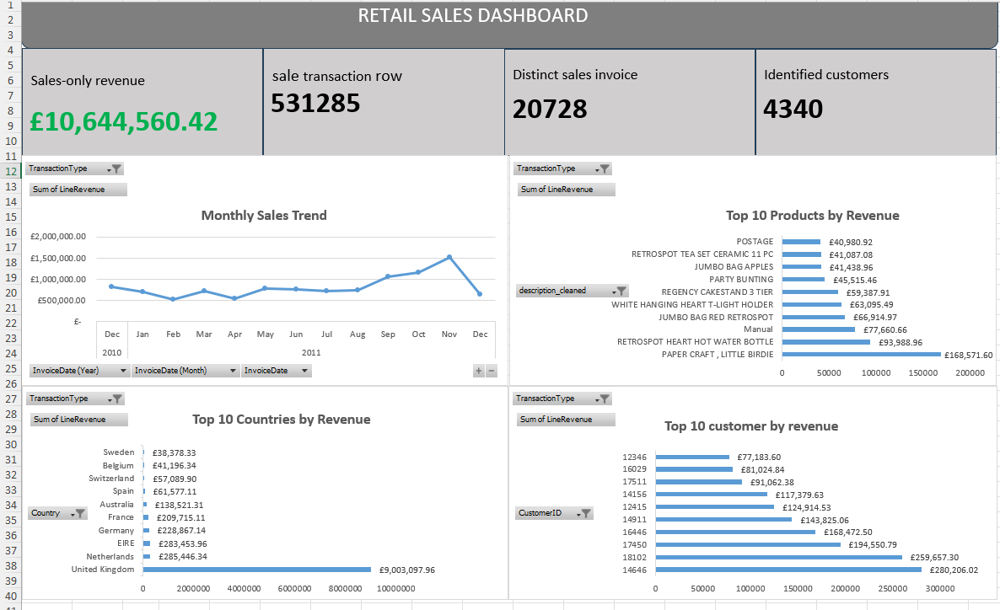

# Retail Sales & Customer Analysis

An Excel-based analysis of retail sales performance and customer behaviour using the UCI Online Retail dataset.

## Project Overview

This project analyses retail transaction data to understand sales performance, identify customer purchasing patterns, and generate actionable business insights.

The analysis was conducted using Microsoft Excel, covering data preparation, data cleaning, KPI calculations, PivotTable analysis, and dashboard development.

## Project Objectives

- Evaluate overall retail sales performance.
- Analyse customer purchasing behaviour.
- Identify sales patterns and trends.
- Calculate key business performance indicators.
- Communicate findings through an interactive Excel dashboard.

## Dataset

- **Source:** [UCI Machine Learning Repository – Online Retail](https://archive.ics.uci.edu/dataset/352/online+retail)
- **Original records:** 541,909
- **Original columns:** 8

## Tools and Techniques

- Microsoft Excel
- Data cleaning and preparation
- Excel formulas
- PivotTables
- KPI calculations
- Data visualization

## Key Performance Indicators

| Metric | Result |
|---|---:|
| Sales-only Revenue | £10,644,560.42 |
| Sales Transaction Rows | 531,285 |

## Project Deliverables

- Excel-based data analysis.
- KPI summary.
- PivotTable analysis.
- Interactive Excel dashboard.
- Final project report.

## Dashboard Preview

The completed dashboard is available in the repository as `Dashboard.png`.

## Project Files

- **Project_Report.pdf:** Final project report.
- **Project_Report.docx:** Editable project report.
- **Dashboard.png:** Dashboard screenshot.
- **Excel Workbook:** Available in the Releases section.

## Conclusion

This project demonstrates the use of Microsoft Excel to transform retail transaction data into meaningful business insights through structured analysis and visualization.

## Author

**DanX-Analyst**

Aspiring Data Analyst | Excel | SQL | Power BI | Python
## Dashboard Preview

